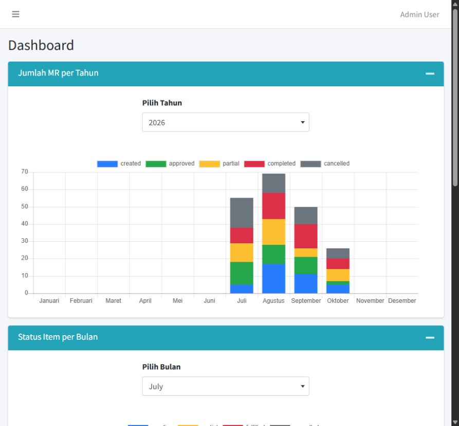
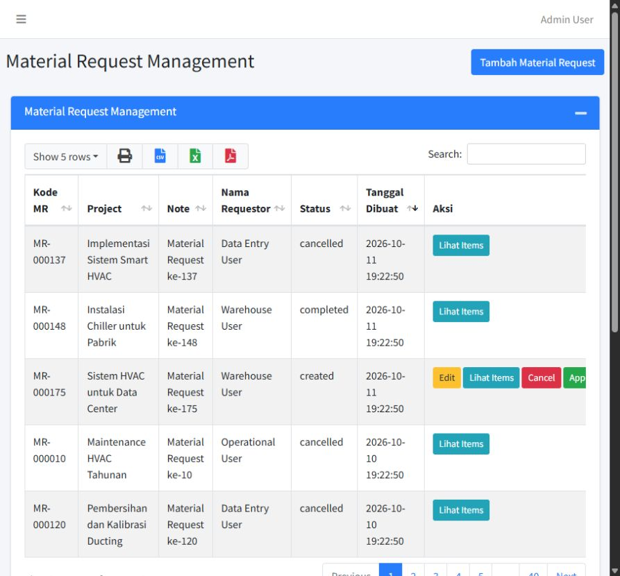

# Material Request

A college thesis project by Doddie Prawarjito: a Laravel application for coordinating project material requests, purchasing, and warehouse fulfilment.

## What it demonstrates

- Material requests with multiple items, quantities, prices, and status tracking.
- Approval, cancellation, partial fulfilment, and warehouse history.
- Project and product master data, including brands, types, and specifications.
- Accounts, roles, and permissions for different departments.
- Dashboard summaries of request status, requested items, and projects.

**Context:** academic thesis; the author reports implementing the complete application. Demo seed data is illustrative. No measured business impact or production deployment is claimed.

## Technology and structure

PHP 8 / Laravel 9, Blade, AdminLTE, Eloquent, MySQL, and Vite.

| Directory | Responsibility |
| --- | --- |
| app/Http/Controllers/MaterialRequest | Requests, projects, warehouse logs |
| app/Http/Controllers/Management | Product and item master data |
| app/Http/Middleware | Route permissions |
| database/migrations | Relational schema |
| database/seeders | Local sample accounts and records |
| resources/views | Blade screens |

## Run locally

Requirements: PHP 8.0.2+ compatible with the locked Laravel 9 dependencies, Composer, Node.js, and MySQL. Use an isolated local database.

```powershell
composer install
Copy-Item .env.example .env
php artisan key:generate
```

Create a database called material_request and set DB_HOST, DB_DATABASE, DB_USERNAME, and DB_PASSWORD in .env. Then:

```powershell
php artisan migrate --seed
npm install
npm run build
php artisan serve --host=127.0.0.1
```

Open http://127.0.0.1:8000. Sample usernames are admin, purchasing, operational, marketing, warehouse, and dataEntry. The existing sample password is password123. These accounts are only for an isolated demo; do not expose a seeded instance publicly.

For a convenient Windows SQLite demonstration after installing PHP and Composer, run [Start-Demo.ps1](Start-Demo.ps1). It creates a new ignored demo database without replacing an existing .env.

## Verification

```powershell
php artisan test
```

Tests use an in-memory SQLite database. Regression checks cover guest redirects, permission denial, and demo fulfilment bounds.

## Portfolio

Read the [case study](docs/CASE_STUDY.md) and [demo walkthrough](docs/DEMO.md). Academic scope and implementation evidence are separated from deployment claims. Before treating this as a production product, review concurrent request numbering, record-level authorization, and transaction boundaries across request/fulfilment operations.

## Demo screenshots





[Validation record](docs/VALIDATION.md).
